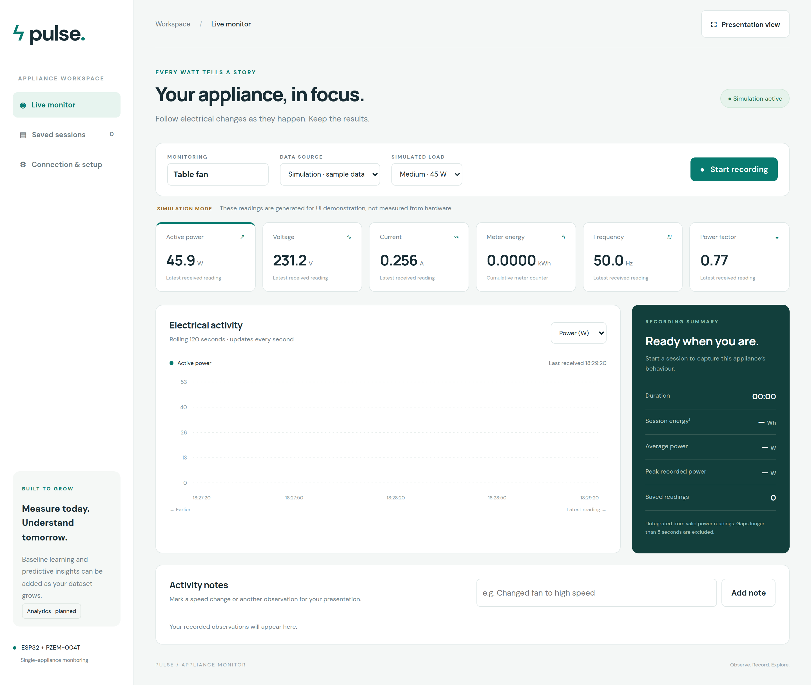
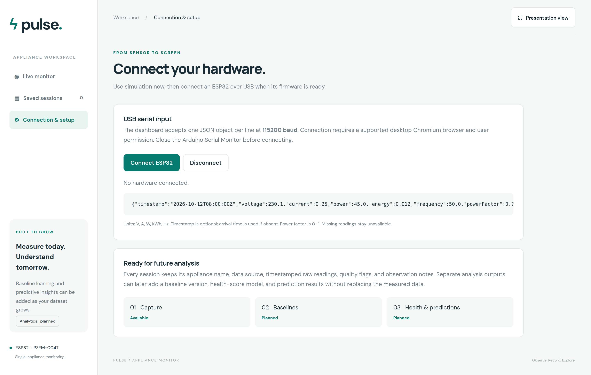
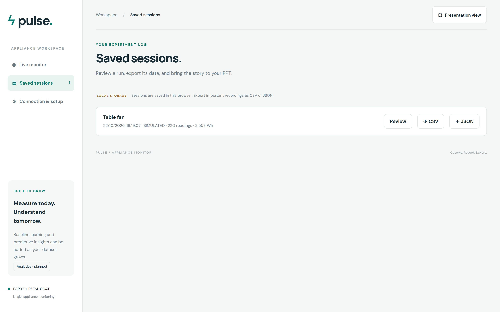

<div align="center">

# ⚡ Pulse — Appliance Monitor

**Live electrical monitoring for a single appliance, straight from an ESP32 over USB.**

No accounts. No cloud. No build step. Just a browser, a USB cable, and a power meter.

[](https://www.espressif.com/en/products/socs/esp32)
[](https://www.arduino.cc/en/software)
[](https://developer.chrome.com/docs/capabilities/serial)
[](https://github.com/mandulaj/PZEM-004T-v30)
[](https://developer.mozilla.org/en-US/docs/Web/HTML)
[](https://developer.mozilla.org/en-US/docs/Web/CSS)
[](https://developer.mozilla.org/en-US/docs/Web/JavaScript)
[](#license)

[**Live demo**](https://do-c-titan.github.io/Pulse-Energy-Monitoring/) · [**Report an issue**](https://github.com/DoC-Titan/Pulse-Energy-Monitoring/issues) · [**Firmware guide**](firmware/Pulse_ESP32_USB/README.md)

</div>

---

<div align="center">
  
</div>

---

## What this is

Pulse turns a **PZEM-004T** power meter into a live electrical dashboard for **one appliance**.

The ESP32 reads the meter over UART and streams one JSON object per second down a USB cable. The browser opens that serial port directly with the **Web Serial API**, normalises the readings, charts them in real time, and lets you record a run and export it as CSV, JSON, or a publication-ready PNG.

Everything is static: three files of HTML, CSS and vanilla JavaScript, plus an Arduino sketch. There is no server, no database, no npm install and no API key.

> **Try it without hardware.** Pick **Simulation · sample data** as the data source and the dashboard runs immediately with a synthetic appliance load.

---

## Features

| | |
| --- | --- |
| 📈 **Live charting** | Power, current and voltage plotted continuously, with a switchable metric and a ~120-second window |
| 🔌 **Web Serial** | Connects straight to the ESP32 over USB — no server in the middle |
| 🎲 **Simulation mode** | Off / Low 28 W / Medium 45 W / High 65 W for demos and UI testing without a device |
| 🗂️ **Saved sessions** | Recorded runs persist in the browser and can be replayed, annotated and deleted |
| 📤 **Three exports** | CSV for spreadsheets, JSON for programs, PNG of the graph for slides |
| 🖼️ **Presentation view** | One click to strip the chrome and show the chart full-screen |
| 📝 **Notes** | Drop timestamped observations onto any session |
| ⚠️ **Honest data** | Missing readings stay `null` and are flagged — never silently replaced with zero |
| 🔒 **Local by design** | Sessions live in `localStorage`. Nothing is uploaded anywhere |
| 📱 **Zero dependencies** | No framework, no bundler, no build pipeline, no external API |

---

## Quick start

### 1. Just look around

Open `docs/index.html` directly in a desktop browser, or visit the [live demo](https://do-c-titan.github.io/Pulse-Energy-Monitoring/). Choose **Simulation · sample data** and press **Start recording**.

### 2. With real hardware

**Hardware**

- ESP32 DevKit / ESP-WROOM-32 (classic ESP32 — **not** C3/S3)
- PZEM-004T-100A **V4** with a current transformer clamp
- A USB **data** cable
- The appliance you want to measure

**Wiring — all power disconnected**

| PZEM pin | ESP32 |
| --- | --- |
| `VCC` | `3V3` |
| `GND` | `GND` |
| `TX` | `GPIO16` (RX2) |
| `RX` | `GPIO17` (TX2) |

> ⚠️ This direct 3.3 V connection is valid **only** for the confirmed compatible PZEM revision. Never feed 5 V into an ESP32 GPIO. See the [safety notes](#safety--read-this-first) before energising anything.

**Flash the firmware**

1. In Arduino IDE, install the **esp32** board package by Espressif Systems and the **PZEM004Tv30** library by Jakub Mandula.
2. Open `firmware/Pulse_ESP32_USB/Pulse_ESP32_USB.ino`, select **ESP32 Dev Module**, and upload with the board unplugged. Hold **BOOT** if the upload stalls at `Connecting…`.

**Stream the data**

1. Open the dashboard → **Connection & setup** → **Connect ESP32**.
2. Pick the ESP32's serial port in the browser's permission dialog.
3. Go to **Live monitor**. The source should read **ESP32 · USB serial**.
4. Name your appliance, wait for numeric readings, then **Start recording** → **Stop & save**.
5. Find the run under **Saved sessions** and export it.

Full detail, including troubleshooting: **[firmware/Pulse_ESP32_USB/README.md](firmware/Pulse_ESP32_USB/README.md)**.

---

<div align="center">
  
</div>

---

<div align="center">
  
</div>

---

## How it works

```
 ┌──────────────┐   UART 9600 8N1   ┌───────────────┐   USB serial 115200   ┌──────────────┐   NDJSON   ┌─────────┐
 │ PZEM-004T    │ ────────────────▶ │ ESP32         │ ────────────────────▶ │ Chrome /    │ ────────▶ │ Dashboard│
 │ 100A + CT    │  voltage/current │ PZEM004Tv30    │  one JSON object     │ Edge (Web   │  parse +  │ charts   │
 └──────────────┘  power/energy    │ library        │  per second + \n     │ Serial API) │  validate  └─────────┘
                                    └───────────────┘                       └──────────────┘
```

1. The ESP32 polls the meter once per second and emits a single JSON line.
2. The browser opens the USB serial port and reads that stream line by line.
3. Every value is validated. Anything non-numeric, negative or out of range becomes `null` with a quality flag.
4. Valid readings update the chart and, while recording, the session buffer.
5. On stop, the session is written to `localStorage` and can be exported.

---

## Data contract

115200 baud, newline-delimited JSON — one complete object followed by `\n`.

```json
{"voltage":230.1,"current":0.080,"power":12.4,"energy":0.012,"frequency":50.0,"powerFactor":0.67,"sensorOk":true,"error":null,"consecutiveErrors":0,"sequence":0,"uptimeMs":1000}
```

| Key | Unit | Accepted value |
| --- | --- | --- |
| `voltage` | V | finite, ≥ 0 |
| `current` | A | finite, ≥ 0 |
| `power` | W | finite, ≥ 0 |
| `energy` | kWh | finite, ≥ 0 (cumulative meter counter) |
| `frequency` | Hz | finite, ≥ 0 |
| `powerFactor` | — | 0 → 1 |

**Diagnostics:** `sensorOk`, `error`, `consecutiveErrors`, `sequence`, `uptimeMs`. The dashboard currently ignores these and does not export them — see [`guides/DATA_FORMAT.md`](guides/DATA_FORMAT.md) for the full contract, the session schema and the export formats.

**Zero is a valid measurement.** A failed sensor read emits all six values as `null` with `sensorOk:false` and `error:"pzem_read_failed"`. The firmware never fabricates a zero in place of a missing value.

---

## Exports

| Format | Contents |
| --- | --- |
| **CSV** | `timestamp, receivedAt, source, voltage, current, power, energy, frequency, powerFactor, quality` — one row per reading |
| **JSON** | The whole session: `schemaVersion`, `id`, `appliance`, `source`, `startedAt`, `endedAt`, `readings`, `notes`, `analysis` |
| **PNG** | A rendered chart of the session, sized for slides |

Session energy is computed in **Wh** by trapezoidal integration of valid adjacent power samples, excluding gaps longer than five seconds. This is deliberately separate from the meter's cumulative kWh counter, which only updates at 1 Wh resolution.

---

## Repository layout

```
Pulse-Energy-Monitoring/
├── docs/                        # the website (GitHub Pages source)
│   ├── index.html               # layout and markup
│   ├── style.css                # styling
│   ├── app.js                   # charts, Web Serial, recording, exports
│   └── .nojekyll                # serves assets verbatim on Pages
├── firmware/
│   └── Pulse_ESP32_USB/
│       ├── Pulse_ESP32_USB.ino  # ESP32 + PZEM-004T sketch
│       ├── README.md            # wiring, upload and troubleshooting
│       └── VALIDATION.md        # historical firmware checks
├── guides/
│   ├── DATA_FORMAT.md           # wire format and session schema
│   └── ROADMAP.md               # planned capabilities
├── assets/                      # README screenshots
├── VALIDATION.md                # export checks
└── README.md
```

---

## Publish with GitHub Pages

The site is already set up for branch-based Pages, and `docs/.nojekyll` is committed.

1. Open **Settings → Pages** in this repo.
2. Under **Build and deployment**, choose **Deploy from a branch**.
3. Select branch **`main`** and folder **`/docs`**, then **Save**.
4. The site publishes to `https://do-c-titan.github.io/Pulse-Energy-Monitoring/`.

Future commits that touch `docs/` are published automatically. Keep filenames and relative links intact.

---

## Safety — read this first

This project touches **mains electricity**.

- **Disconnect mains and USB before changing any wiring.**
- The CT clamp must surround **only the insulated live conductor** feeding the appliance — not the whole extension cable, and not only the PZEM voltage-sensing wire.
- Keep the CT leads on the correct CT terminals before energising.
- Electronics ground is **not** mains neutral or protective earth.
- Have the modified extension, wire ratings, terminations, strain relief and enclosure checked by a **qualified electrician**.
- Never operate exposed mains next to a USB-connected computer.

---

## Troubleshooting

| Symptom | Try this |
| --- | --- |
| No COM port | Data-capable USB cable, correct board and port, board's USB driver |
| Port busy / browser cannot open it | Close Arduino Serial Monitor, Serial Plotter and any other tab using the port |
| A few junk lines after reset | ESP32 ROM boot text is not JSON — only sketch output is |
| Every metric shows a dash | Sensor AC supply, communication VCC/GND, crossed TX/RX, correct UART pins |
| Voltage and frequency fine but power is ~0 | No real load running, or the CT is not around the right conductor |
| Small charger load poorly resolved | The 100 A CT has a low-current measurement limit |
| Meter kWh barely moves | 1 Wh meter resolution — session energy integrates power and updates sooner |
| Sensor errors recover on their own | Expected: the firmware retries every interval, no reset needed |

---

## Roadmap

These are **planned capabilities, not active features**. See [`guides/ROADMAP.md`](guides/ROADMAP.md).

1. **Baseline learning** — derive an appliance-specific normal operating range from exported sessions.
2. **Health scores** — a documented, validated score with versioned inputs and explanations.
3. **Failure prediction** — only after collecting labelled examples of normal operation and failures.
4. **Wi-Fi and continuous collection** — a secured ingestion backend, with credentials kept out of the frontend.

---

## Credits

- [PZEM-004T-v30 Arduino library](https://github.com/mandulaj/PZEM-004T-v30) by Jakub Mandula
- [MycilaPZEM](https://github.com/mathieucarbou/MycilaPZEM) for v3/v4 protocol compatibility notes
- [ESP32 Arduino core](https://docs.espressif.com/projects/arduino-esp32/en/latest/installing.html)
- [Web Serial API](https://developer.chrome.com/docs/capabilities/serial) · [GitHub Pages](https://docs.github.com/en/pages)

---

## License

Released under the **MIT License**. See [`LICENSE`](LICENSE).
